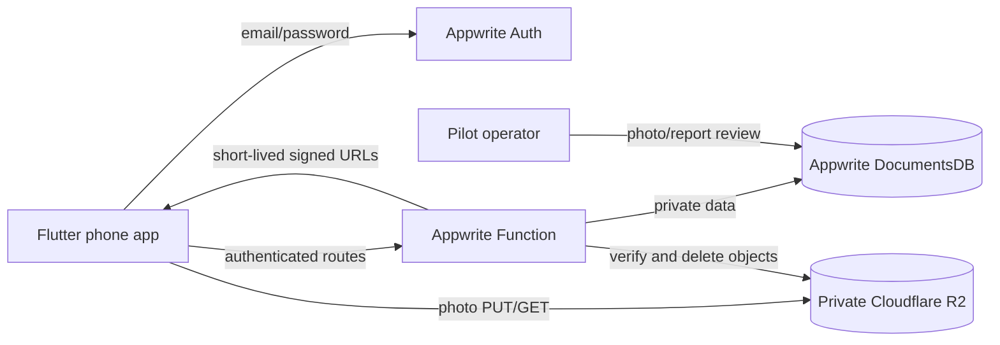

# Kindred architecture: Flutter + Appwrite + Cloudflare R2

**Status:** code exists in this repository; cloud services are not deployed yet.

Appwrite and Cloudflare provide the online infrastructure. The founder's computer can be off. Appwrite remains a server service, while R2 holds images outside Appwrite's storage quota. Both providers have separate free limits and possible billing conditions.

## Trust boundaries

- The Flutter app holds a user's Appwrite session and public project configuration only. It never contains an Appwrite admin key or R2 secret.
- The Function checks the invoking user's Appwrite JWT, then performs all profile, discovery, match, chat, block, report, and photo authorization. DocumentsDB collections have no direct client permissions.
- R2 bucket access is private. The Function issues short-lived upload or download URLs after checking the user and target profile. A signed URL is a temporary bearer credential.
- A pilot operator uses a separate, private setup key to review pending photos and reports.

## Data and routes

| DocumentsDB collection | Contents |
| --- | --- |
| `profiles` | Public fields plus private birth date, photo keys, review state |
| `likes`, `passes` | One decision per directed user pair |
| `matches` | One canonical ID per mutual pair |
| `messages` | Text and match ID; only unblocked matches can read/write |
| `blocks` | Directed blocks that suppress discovery and chat |
| `reports` | Private user reports and review state |
| `uploads` | R2 keys, MIME, size, and moderation status |

The Flutter app calls the Function at `/api/profile`, `/api/me`, `/api/discover`, `/api/users/{id}/{like|pass|block|report}`, `/api/matches`, `/api/messages/{id}`, `/api/blocks`, `/api/photo/*`, and `/api/account`. The Function returns safe public profile fields to other users; birth date and email stay private. It enforces the 18+ birth-date gate, mutual preferences, matching, blocking, and account deletion.

## Photo flow

1. The app shrinks a chosen photo and requests `/api/photo/prepare`. The Function checks MIME and a 350 KB declared size, creates a random temporary key, and signs a 60-second R2 PUT URL.
2. The phone uploads directly to R2 and calls `/api/photo/complete`. The Function checks object size, content type, and file signature.
3. The Function writes verified bytes under a different private key that was never signed for PUT. This prevents reuse of the temporary upload URL from changing the reviewed object.
4. The photo remains hidden until a pilot operator approves it. Approved profiles receive 90-second R2 GET URLs after authorization checks. Blocking or deletion stops new URL issuance, though an already-issued URL can work until it expires.

A signed PUT does **not** stop an abusive client from storing an oversized object before completion checks. Limit uploads at the edge and clean abandoned objects before opening public registration. The current Function removes stale prepared objects when the same user requests another upload; a global scheduled cleanup is still needed.

## Pilot boundary

The code is a pilot, not a public dating service. Add verified contact methods, dependable adult age assurance, stronger upload limits, message/image moderation, rate limits, backup and recovery, and legal/privacy review before launch. The birth-date field alone does not verify age. The Function code and setup instructions are in [cloud/README.md](cloud/README.md).

References: [Appwrite Functions](https://appwrite.io/docs/products/functions/develop), [DocumentsDB](https://appwrite.io/docs/products/databases/documentsdb/collections), [Cloudflare R2 signed URLs](https://developers.cloudflare.com/r2/api/s3/presigned-urls/).
